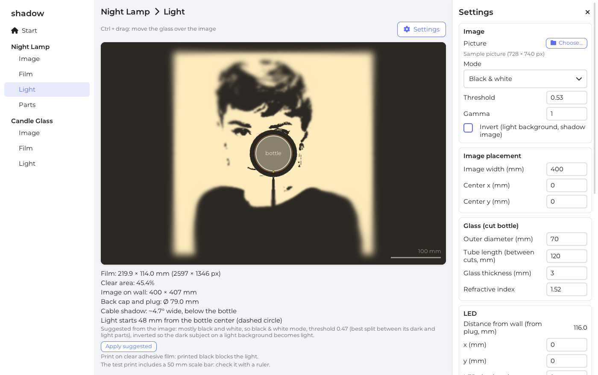
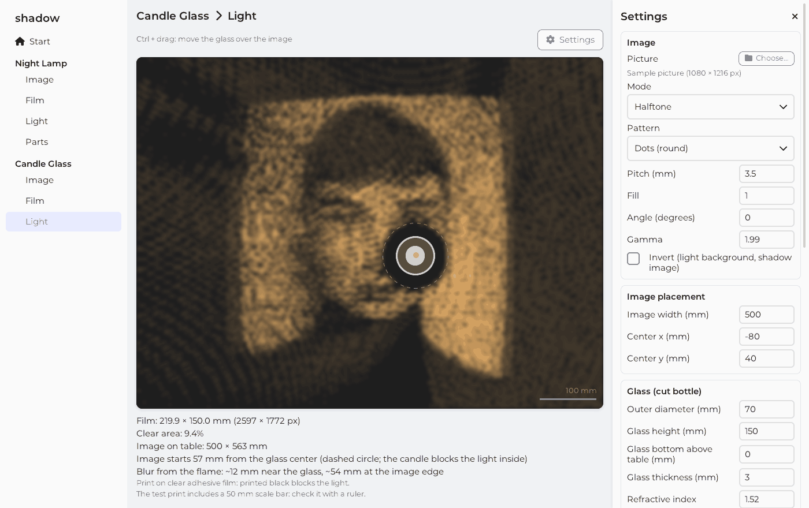
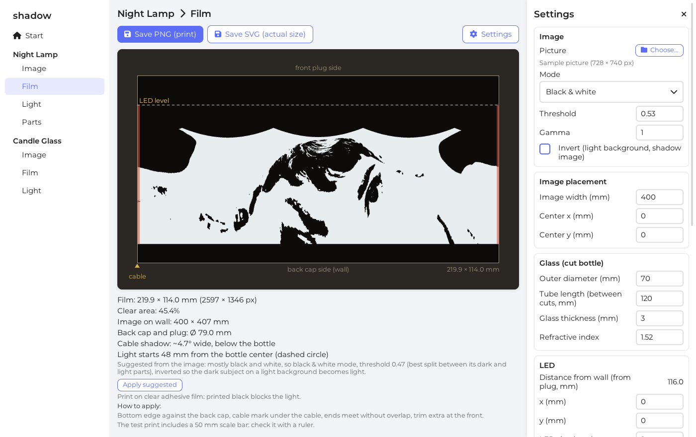
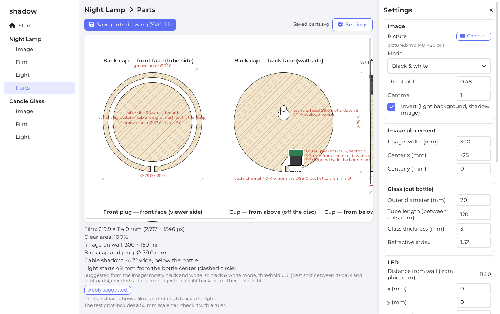

# shadow

A desktop design tool for "shadow bottle" lights, written in Zig with LVGL and SDL3.

A cut glass bottle with a light inside draws a picture through a patterned film
wrapped around it: on the wall for the **night lamp**, on the table around the glass
for the **candle glass**. Choose a picture, enter the sizes of the glass and the light,
and shadow computes the film that throws that picture, shows how the light will look,
and saves the film for printing or laser engraving.



## Products

- **Night Lamp**: a glass tube hung on the wall, an LED inside facing the wall. The
  tube sits in a wooden back cap (USB-C power) and is closed by a removable front plug
  that holds the circuit; the cable runs along the outside of the glass, always at the
  bottom. Includes a 1:1 drawing of the wooden parts.
- **Candle Glass**: a glass standing on the table with a real candle or an LED candle
  inside. The film is computed for a design flame height: a real candle's image comes
  into focus as it burns down to that height.



The flame sways, rises and pulses; since the glass is close to the flame and the
table is far, a millimeter of movement moves the image a lot, as with a real candle.

## Features

- Pages for each product: **Image** (the picture on the wall or table), **Film** (the
  unrolled film), **Light** (the result), and **Parts** for the night lamp.
- Black & white or halftone (dots, squares, lines, wavy lines, crosshatch, concentric
  rings, spiral), with threshold, gamma, pitch, fill, angle and invert.
- Settings suggested from the picture (threshold or gamma, pitch for the light size),
  applied with one click.
- Glass refraction, the LED size or flame size as blur, the cable's shadow, the area
  the candle itself blocks, and a flickering, animated flame (real candle, LED
  tealight, moving-flame LED). The candle's current flame height can be simulated.
- **Ctrl + drag** on the drawing moves the glass over the picture.
- Warnings when parts do not fit (thin back cap, short cup, candle too close to the
  glass, flame above the glass, ...).
- Pattern methods: printed clear film, painted glass + rotary laser, or laser frosting.
- Saved files:
  - film for printing: PNG at actual size (resolution stored in the file) with the cut
    border, labels and a 50 mm scale bar to check with a ruler; or the same in an SVG
    with its size in mm;
  - plain pattern for the rotary laser (black = laser fires);
  - parts drawing of the night lamp as SVG, 1:1.
- Pictures: PNG, JPEG, BMP, GIF, TGA, PSD, PNM. The app opens with a sample portrait
  (`assets/sample_portrait.jpg`).





## Usage

```sh
shadow                 # then choose a picture in the settings panel
shadow picture.png     # opens the night lamp with this picture
```

| Key | Action |
|---|---|
| Ctrl+O | Choose a picture |
| Ctrl + drag | Move the glass over the picture (Image and Light pages) |
| Enter | Take the typed number |
| Esc | Close the settings panel |
| Ctrl+V | Paste into the text field |

On macOS, Cmd works in place of Ctrl.

Applying the film: on the night lamp, the bottom edge goes against the back cap, the
"cable" mark under the cable, the ends meet without overlap and the extra is cut at
the front. On the candle glass, the film starts at the bottom edge of the glass; an LED
candle's light must be as high above the table as the "Design flame height". The
calculation assumes a straight cylinder, so measure the real outer diameter of the
glass.

## Building

The only requirement is Zig 0.17.1. LVGL, SDL3 and stb are fetched and built by the
Zig build system; nothing else needs to be installed.

```sh
zig build                          # debug build: zig-out/bin/shadow
zig build -Doptimize=ReleaseSmall  # about 5 MB
zig build run -- picture.png
```

Windows build (from Linux or Windows):

```sh
zig build -Dtarget=x86_64-windows -Doptimize=ReleaseSmall   # zig-out/bin/shadow.exe
```

The result is a single `shadow.exe` that only uses DLLs that come with Windows 10 and
later.

macOS Application Bundle (on macOS):

```sh
zig build app -Doptimize=ReleaseSmall   # zig-out/Shadow.app
```

Creates a signed, standalone `Shadow.app` bundle with high-DPI (Retina) support and app icon.

## Tests

```sh
zig build test
```

checks the calculation against reference results of the first version of the tool
(`test/reference/`): film size and pixels, where the light lands, blur, part sizes,
warnings, halftone patterns, and the parts SVG byte for byte.

The in-app test drives the real UI without opening a window (changes settings, opens a
picture, drags the glass, saves every kind of file and checks them):

```sh
SHADOW_TEST=1 SDL_VIDEO_DRIVER=offscreen SHADOW_TEST_DIR=/tmp/shadow-test ./zig-out/bin/shadow
```

On macOS, use `SDL_VIDEO_DRIVER=dummy SDL_RENDER_DRIVER=software` for offscreen test runs:

```sh
SHADOW_TEST=1 SDL_VIDEO_DRIVER=dummy SDL_RENDER_DRIVER=software SHADOW_TEST_DIR=/tmp/shadow-test ./zig-out/bin/shadow
```

It prints `test: ok` at the end. Add `SHADOW_SHOT=<dir>` to save screenshots.

## Platforms

- **Linux:** developed and tested on Linux (X11).
- **Windows:** builds for Windows (see above), but has not been tested on Windows yet.
- **macOS:** tested on macOS (Apple Silicon arm64). `zig build app -Doptimize=ReleaseSmall`
  builds and signs a native `Shadow.app` bundle. Building for macOS from another OS is not
  supported, as it needs Apple's SDK.

Built with [Claude Code](https://claude.com/claude-code). I defined the
features and requirements, chose the tools (Zig, LVGL, SDL3, stb),
reviewed the results and tested the app; Claude wrote most of the code.

## License

MIT (see `LICENSE`). Bundled fonts: Montserrat (SIL Open Font License, `assets/Montserrat-OFL.txt`) and
Font Awesome Free (`assets/FontAwesome-LICENSE.txt`).
